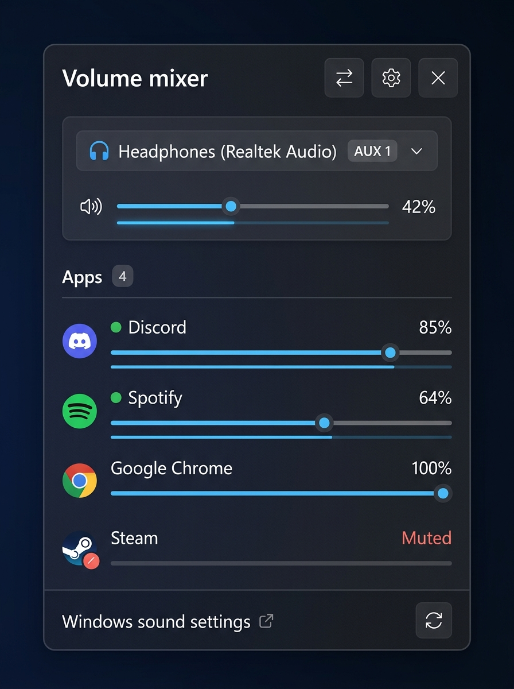
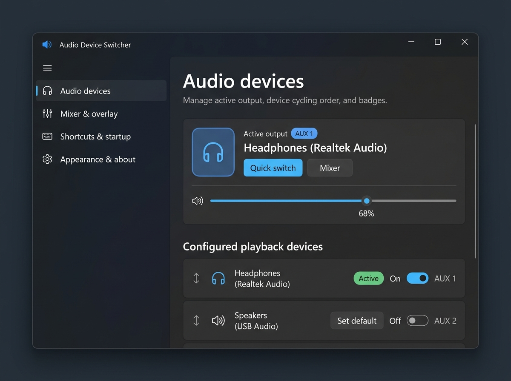

<div align="center">

# 🎧 Audio Device Switcher

**A modern Windows 11 Fluent 2 audio device switcher and per-application volume mixer built with WinUI 3.**

[](#)
[](#)
[](#)
[](https://github.com/Kwan-desu/AudioDeviceSwitcher/actions/workflows/build.yml)
[](https://github.com/Kwan-desu/AudioDeviceSwitcher/releases/latest)

[Download Latest Release](#installation) • [Features](#-features) • [Shortcuts & Controls](#%EF%B8%8F-controls--shortcuts) • [Build from Source](#%EF%B8%8F-building-from-source) • [Report Bug](https://github.com/Kwan-desu/AudioDeviceSwitcher/issues)

</div>

---

## 🖼️ Preview

<table>
  <tr>
    <td align="center" width="42%">
      
      <br />
      <strong>Acrylic Volume Mixer Flyout</strong>
      <br />
      <sub>Live peak meters, inline device switcher, scroll-wheel volume &amp; muted badges</sub>
    </td>
    <td align="center" width="58%">
      
      <br />
      <strong>Fluent 2 Settings Window</strong>
      <br />
      <sub>NavigationView sidebar, Active Output hero card, drag-and-drop device ordering</sub>
    </td>
  </tr>
</table>

---

## ✨ Features

- **🎨 Native Windows 11 Fluent 2 UI** — Built with WinUI 3, true Desktop Acrylic flyouts, Mica / Mica Alt settings backdrops, and automatic Light, Dark, and High Contrast theme support.
- **🎛️ Live Per-Application Volume Mixer** — Adjust or mute individual apps (Discord, Spotify, Chrome, Games) right from the system tray with real-time WASAPI audio peak meters, active-audio indicators, hover cards, and mouse-wheel scrolling over any row.
- **⚡ Instant Output Switching** — Bounce between headphones, speakers, and monitors via the inline mixer dropdown, tray double-click, or a customizable global hotkey (`Ctrl + Shift + S`).
- **🖱️ Taskbar Scroll Volume** — Hover over the system tray icon and roll the mouse wheel to adjust master volume with configurable step sizes (`1%`, `2%`, `5%`, `10%`).
- **🖥️ Click-Through On-Screen Display (OSD)** — Non-intrusive, focus-safe Acrylic HUD overlay confirming volume adjustments and playback device switches without interrupting fullscreen games.
- **🔌 Smart Reconnection & Ordering** — Drag-and-drop or arrow-key reorder your quick-switch device cycle, assign custom taskbar badges (`AUX 1`, `HDPH`, etc.), and automatically preserve settings when USB/Bluetooth devices unplug and reconnect.
- **🚀 Startup & Built-in Auto-Updater** — Launch silently minimized to the tray on Windows startup and update automatically from GitHub Releases.

---

## ⌨️ Controls & Shortcuts

| Action | Default Trigger |
| :--- | :--- |
| **Open Volume Mixer** | Single left-click tray icon, middle-click tray icon, or `Ctrl + Shift + M` |
| **Quick Switch Output Device** | Double left-click tray icon or `Ctrl + Shift + S` |
| **Adjust Master Volume** | Scroll mouse wheel over tray icon or over the mixer's master slider |
| **Adjust App Volume** | Drag slider or scroll mouse wheel directly over any app row |
| **Mute / Unmute App** | Click the app's icon button in the Volume Mixer |
| **Close Volume Mixer** | Press `Esc` or click outside the flyout |

---

## 🚀 Installation

### Option 1: Standalone Portable Executable (Recommended)
1. Download **[AudioDeviceSwitcher.exe](https://github.com/Kwan-desu/AudioDeviceSwitcher/releases/latest/download/AudioDeviceSwitcher.exe)** from the [Releases](https://github.com/Kwan-desu/AudioDeviceSwitcher/releases/latest) page (or grab the latest CI build from [GitHub Actions](https://github.com/Kwan-desu/AudioDeviceSwitcher/actions/workflows/build.yml)).
2. Place `AudioDeviceSwitcher.exe` anywhere on your PC and run it.
3. Access the mixer, quick switcher, and settings anytime from your System Tray.

### Option 2: Windows Installer
1. Download **[AudioDeviceSwitcherInstaller.exe](https://github.com/Kwan-desu/AudioDeviceSwitcher/releases/latest/download/AudioDeviceSwitcherInstaller.exe)**.
2. Run the guided installer to set up shortcuts and optional Windows startup.

---

## 🛠️ Building from Source

Requires **Windows 10/11**, **Visual Studio 2022+ (MSBuild)**, and the **.NET 8.0 SDK**.

```powershell
# Clone the repository
git clone https://github.com/Kwan-desu/AudioDeviceSwitcher.git
cd AudioDeviceSwitcher

# Publish the WinUI 3 application (win-x64)
msbuild AudioDeviceSwitcher.WinUI\AudioDeviceSwitcher.WinUI.csproj `
  /t:Restore,Publish `
  /p:Configuration=Release `
  /p:Platform=x64 `
  /p:RuntimeIdentifier=win-x64 `
  /p:SelfContained=true `
  /p:PublishDir="..\publish\winui\"
```

---

## 🏗️ Project Structure

- [`AudioDeviceSwitcher.WinUI/`](AudioDeviceSwitcher.WinUI/) — Primary Windows 11 WinUI 3 / Windows App SDK application (Volume Mixer, Settings, OSD, WASAPI session & peak meter manager, global hotkeys, tray manager).
- [`AudioDeviceSwitcherInstaller/`](AudioDeviceSwitcherInstaller/) — Dual-mode single-file C# bootstrapper that runs as either a portable launcher or GUI installer.
- [`AudioDeviceSwitcher/`](AudioDeviceSwitcher/) — Legacy WPF/WinForms implementation kept for reference.

---

## 🤝 Contributing & License

Contributions, bug reports, and feature ideas are welcome on the [Issues](https://github.com/Kwan-desu/AudioDeviceSwitcher/issues) page. This project is open-source and free to use.
